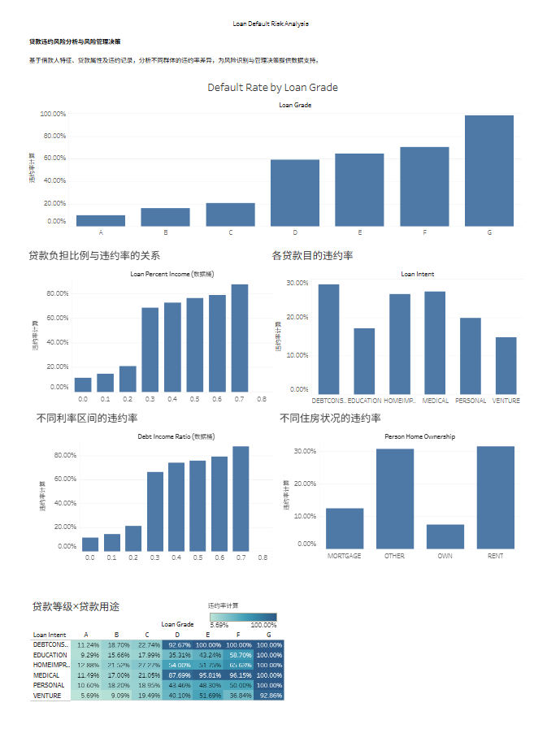

# 信贷违约风险分析与风险管理决策分析
数据分析求职作品集项目

## 项目目标
- 对整体贷款样本进行初步探查，了解数据的基本分布。
- 比较不同信用等级、贷款用途及住房类型下的违约率差异。
- 通过多维交叉分析，识别出违约风险较高的组合类型。
- 将分析结果可视化展示，形成初步的业务建议，为数据驱动型决策提供数据支持。

## 使用工具
1. MySQL(SQL)：原始数据探查，做初步EDA；探索性数据分析，单特征违约率统计，多变量交叉风险分析。
2. Python（pandas）：原始数据清洗，缺失值，异常值业务处理，输出清洗后的干净数据集。
3. Tableau：制作交互式可视化仪表盘，对分析结果进行可视化展示，支持信贷风控业务决策。

## 项目目录
```tree
├── assets/  #可视化截图资源文件夹
│   ├── .gitkeep
│   ├── 各等级贷款违约率.png
│   ├── 各贷款目的违约率.png
│   ├── 贷款等级×贷款用途.png
│   └── dashboard_preview.png
├── data/
│   └── .gitkeep
├── python/
│   ├── .gitkeep
│   └── data_clean.py  #数据清洗代码
├── sql/
│   ├── .gitkeep
│   ├── first_eda.sql  
│   └── clean_data_analysis.sql  #对数据进行详细业务分析
├── tableau/ 
│   ├── .gitkeep
│   └── credit_risk_tableau.twbx
├── conclusion.md   #分析结论与业务落地建议
└── README.md
```

## 分析流程
1. 原始数据导入MySQL，第一轮EDA探查：统计样本量、缺失值，识别业务异常值，了解原始数据概况。
2. 导出原始CSV，使用Pandas进行数据清洗：剔除异常样本、处理缺失值，导出清洗后的干净数据集。
3. 将清洗后的干净数据再次导入MySQL，开展业务分析：计算整体违约率，完成单特征、多特征交叉风险分析。
4. 提取SQL统计结果，接入Tableau，搭建可视化仪表盘。
5. 整理分析结论，输出信贷风控业务建议。

## 数据集来源
kaggle credit_risk_dataset
[数据下载地址](https://www.kaggle.com/datasets/laotse/credit-risk-dataset)
> 需要自行去Kaggle下载数据集，将CSV文件放置到本地`data/`文件夹，才能运行代码。
> 本仓库只存放代码，不存储原始数据文件。

## 项目结论
1. **核心风险因子**：贷款等级、负债收入比 DTI、雇佣时长、贷款用途、历史逾期，是违约最强预测变量。
2. **风险分层**：A/B 级低风险可放量；C 级标准审批；D/E 级建议严格审核，或降低贷款额度；**F/G 级违约最为严重，不建议放贷**。
3. **DTI 阈值**：DTI＞35% 违约明显抬升，审批优先看相对负债，而非绝对收入。
4. **高危用途**：**债务整合（以贷养贷）风险最高**；教育、家装、大件采购风险更低。
5. **就业稳定性**：雇佣时长＜1 年为高危信号，容易和高 DTI 形成风险叠加。
6. **逆向选择提醒**：高利率客群违约显著更高，**利率提升不一定提升净利润**。
7. **客群策略**：年轻薄征信客群适合小额授信；30–45 岁、长期稳定就业客群资质最优。
8. **准入红线组合**：债务整合 + 入职＜1 年 + DTI＞35%，建议严格限制或拒贷。
> 本处为精简摘要，带图表对照的完整详细业务结论：[conclusion.md](./conclusion.md)


## 项目亮点
1. 多工具协同分析：MySQL、Pandas、Tableau协同分析，各司其职，还原真实分析师工作流。
2. 基于Kaggle真实开源信贷数据集开展分析，贴近真实业务场景，获得落地的业务分析体验。
3. 区分“数据探查”和“正式分析”两个阶段，分两次入库，避免脏数据干扰分析结论。

## 可视化成果
Tableau交互式仪表盘

> 目前已完成核心分析图表及交互式仪表板，主要围绕贷款信用等级、贷款用途、住房类型、贷款收入占比及贷款利率等维度展开分析。

## 数据质量与局限性
1. 静态截面数据，无时间维度，无法考察贷款周期与宏观环境变化；
2. loan_status 为二分类标签，无逾期程度以及回收金额信息;
3. 利率缺失 9.56% 且缺失机制未知;
4. 年龄/工龄存在极端异常值；
5. 未含地区、职业、负债等更多画像字段。
