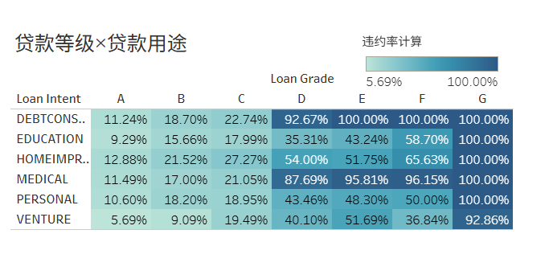
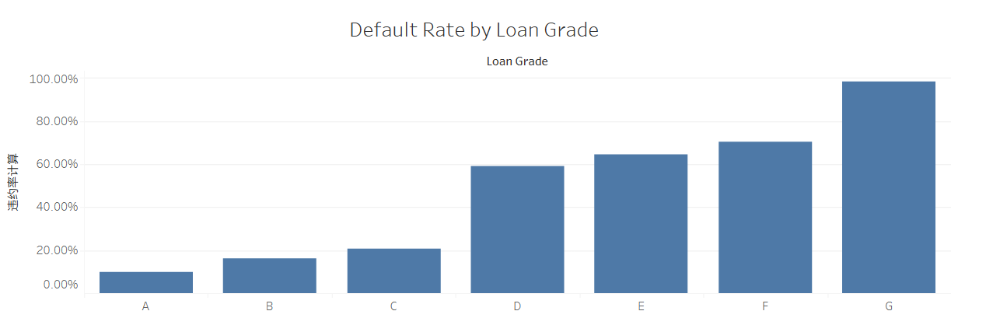
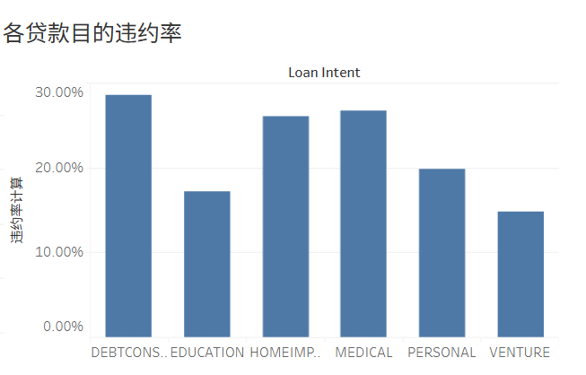

# 信贷风险分析 - 业务结论与洞察
> 基于Kaggle公开信贷数据集，使用Python(Pandas)数据清洗、MySQL探索性分析、Tableau可视化完成描述性风控分析

## 一、核心摘要
本项目对信贷申请样本开展EDA分析，挖掘影响贷款违约的关键特征，输出可落地的风控审批策略。
数据集样本总量32581条，整体违约率21.8%。
通过单变量、多变量交叉统计，识别出贷款等级、负债收入比DTI、雇佣时长、贷款用途、历史逾期为核心风险因子，并总结高风险客群组合。

## 二、关键业务洞察
### 1. 核心风险因子
贷款等级、负债收入比DTI、雇佣时长、贷款用途、历史逾期，是违约最强预测变量。

> 图注：热力图展示多特征交叉下的违约率分布，直观识别高风险特征组合

### 2. 贷款等级风险分层
A/B级低风险可放量；C级标准审批；D/E级建议严格审核，或降低贷款额度；F/G级违约最为严重，不建议放贷。

### 3. 负债收入比DTI阈值
**DTI＞35%违约明显抬升**，审批优先看相对负债，而非单纯看绝对收入。
> 业务理解：同样月收入1万，负债4000和负债1000，偿债压力差异远大于收入数字本身。

### 4. 贷款用途风险差异
**债务整合（以贷养贷）风险最高**；教育、家装、大件采购风险更低。

### 5. 就业稳定性
**雇佣时长＜1年为高危信号**，容易和高DTI形成风险叠加。

### 6. 利率逆向选择提醒
高利率客群违约显著更高，利率提升不一定提升净利润。
> 业务理解：逆向选择——愿意接受高利率的申请人，本身资质更差，坏账侵蚀利息收益。

### 7. 客群授信策略
年轻薄征信客群适合小额授信；30–45岁、长期稳定就业客群资质最优。

### 8. 高风险准入红线组合
**债务整合 + 入职＜1年 + DTI＞35%，建议严格限制或拒贷**。

## 三、风控落地建议
1. 准入策略：把上面三重高危组合设置为审批强拦截规则；
2. 分级审批：按贷款等级差异化授信额度、审批流程；
3. 额度管控：高DTI、短期入职人群压缩授信上限；
4. 贷后管理：债务整合类贷款重点增加贷后跟踪预警；
5. 定价策略：不能单纯依靠提高利率覆盖风险，需要结合准入过滤。

## 四、项目局限性
1. 数据集无时间序列字段，无法观察逾期随时间变化，不能做时序逾期追踪；
2. 缺少详细征信报告、历史还款流水这类强风控字段，识别能力有限；
3. 本项目仅为描述性统计分析，没有搭建评分卡、机器学习模型，结论仅作为策略参考，不可直接线上投产；

